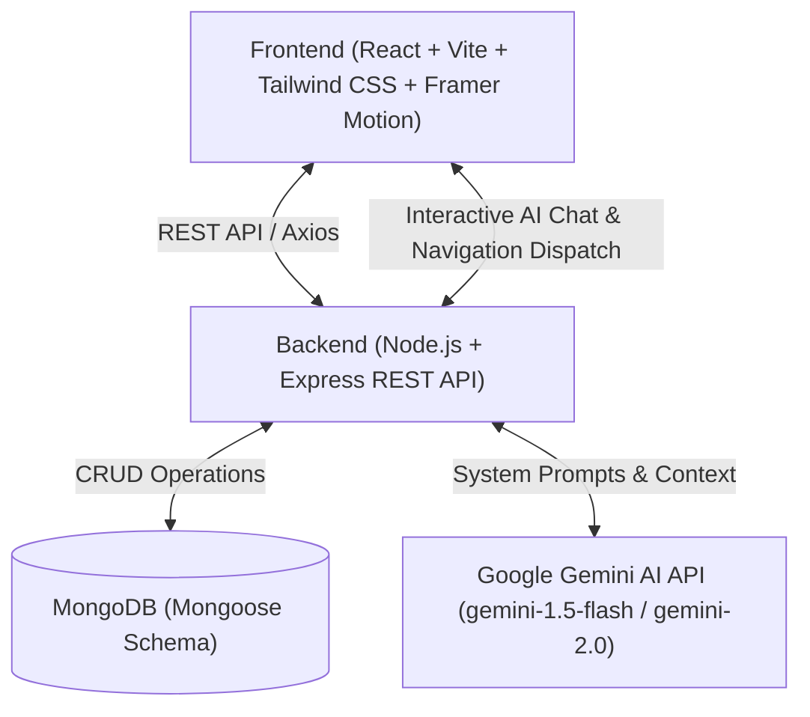

# 🚀 DailyTracker AI (MERN + Gemini AI)

> An intelligent, date-based personal productivity, learning, and career tracker powered by the **MERN Stack** and **Google Gemini AI**. Plan your morning goals, track what you studied, log job applications, visualize your daily accomplishments in a stunning UI, and interact with an AI assistant that knows your journey.

---

## 📌 Project Overview & Vision

**DailyTracker AI** is designed to transform daily self-tracking into an effortless, inspiring routine. Instead of scattered notes and fragmented to-do apps, each day is encapsulated into a rich, structured **Daily Card**.

### 🌟 Key Core Highlights
1. **Morning Planner (To-Do Checklist)**: Start your morning with intent. Add tasks with descriptions and priority. Checking a box automatically logs it as completed in your daily achievements.
2. **Study & Skill Logs**: Record technical topics (e.g., Git, GitHub, Docker, System Design, Algorithms) with in-depth descriptions, takeaways, and tags.
3. **Job Applications Tracker**: Log company names, job titles, application links, referral info, and status updates directly within that day's card.
4. **Dedicated Dedicated Multi-Page Experience**:
   - ✍️ **Write / Plan Page (`/write` or `/cards/:date/edit`)**: Distraction-free editing, morning checklist, and quick logging.
   - 👁️ **Visualizer Page (`/cards/:date`)**: A visually captivating, aesthetic showcase of what you achieved on that specific day (badges, metrics, formatted markdown, modern bento-grid UI).
   - 🗂️ **All Cards Hub (`/cards`)**: Searchable timeline and calendar grid showing streaks, tags, and summary previews.
5. **Gemini AI Deep Integration**:
   - 🧭 **Voice / Text Command Navigation**: Tell the AI *"Open card for 2026-11-20"* or *"Open the day I studied Docker"* — Gemini parses intent and directly opens the card.
   - 💬 **Contextual Chatbot**: Ask Gemini questions like *"What did I accomplish this week?"*, *"Quiz me on the Docker concepts I studied today"*, or *"Give me interview tips for the frontend role I applied to at Razorpay today."*

---

## 🏗️ Architecture & Tech Stack



### 💻 Technologies
- **Frontend**:
  - **React 18** (Vite for fast build times)
  - **Tailwind CSS** + **Framer Motion** (Sleek dark/light theme, modern cards, smooth transitions, glassmorphism)
  - **Lucide Icons** (Crisp vector iconography)
  - **React Router Dom v6** (Clean multi-page routing)
  - **React Markdown** (Rich text rendering for study notes)
- **Backend**:
  - **Node.js** & **Express.js** (Modular RESTful architecture)
  - **Mongoose** (Strict date-indexed schemas)
  - **Google Generative AI SDK (`@google/genai` or `@google/generative-ai`)**
- **Database**:
  - **MongoDB** (Local or MongoDB Atlas)

---

## 📂 Page Structure & Navigation

The app is divided into three distinct, dedicated pages as requested:

```
├── 1. 🗂️ All Cards Gallery (/cards)
│   ├── Search bar (search by study topic, company name, or date)
│   ├── Filter by status / tags
│   ├── Streak tracker & Weekly summary cards
│   └── Clickable cards leading to either Visualizer or Editor
│
├── 2. ✍️ Write & Plan Card (/cards/:date/edit or /write)
│   ├── Morning To-Do Checklist (Dynamic checkbox -> auto-sync to completed)
│   ├── Study & Learnings Logger (Topic, Description, Tags, Code snippets)
│   ├── Job Application Logger (Company, Role, Platform, Notes)
│   └── Save / Auto-draft functionality
│
├── 3. 👁️ Visualizer Card (/cards/:date)
│   ├── Hero Date Header with mood / day summary
│   ├── Completed Tasks Showcase with progress ring
│   ├── Deep-Dive Study Section (formatted notes, tags)
│   ├── Applied Jobs Section (Status pills, company logos/cards)
│   └── "Ask Gemini about this day" quick action button
│
└── 🤖 Gemini AI Floating Drawer / Chatbot (Available Across All Pages)
    ├── Smart Command: "Open card for [Date]" -> Direct redirection
    ├── Contextual Q&A on your study topics
    └── Job interview prep & resume advice based on applied roles
```

---

## 🗄️ Data Model (MongoDB Schema)

```javascript
// models/DailyCard.js
const DailyCardSchema = new mongoose.Schema({
  date: { 
    type: String, // Format: YYYY-MM-DD (Indexed for fast lookup)
    required: true, 
    unique: true 
  },
  
  // Morning Planning & Checklist
  morningTasks: [
    {
      id: String,
      task: { type: String, required: true },
      description: String,
      isCompleted: { type: Boolean, default: false },
      completedAt: Date
    }
  ],

  // What you studied today
  studyLogs: [
    {
      topic: { type: String, required: true }, // e.g., "Docker", "Git & GitHub"
      description: { type: String, required: true },
      tags: [String], // e.g., ["DevOps", "Version Control"]
      resources: [String]
    }
  ],

  // Job Applications
  jobsApplied: [
    {
      companyName: { type: String, required: true },
      role: String,
      jobLink: String,
      notes: String,
      status: { 
        type: String, 
        enum: ['Applied', 'Screening', 'Interviewing', 'Offer', 'Rejected'], 
        default: 'Applied' 
      }
    }
  ],

  // Summary / AI Notes
  dailyReflection: String,
  aiSummary: String
}, { timestamps: true });
```

---

## 🤖 Gemini AI Capabilities & Prompts

### 1. Smart Navigation & Action Dispatcher
* **User Input**: *"Take me to the card for November 15, 2026"* or *"Show me when I learned Docker."*
* **Gemini Function**: Analyzes user intent, checks matching card dates, and returns an action payload:
  ```json
  {
    "action": "NAVIGATE_TO_CARD",
    "targetDate": "2026-11-15",
    "message": "Opening your card for November 15, 2026 where you worked on Docker containers."
  }
  ```
  The React frontend catches this event and immediately triggers `navigate('/cards/2026-11-15')`.

### 2. Contextual Learning Partner & Coach
* **User Input**: *"Quiz me on what I studied today about Git rebasing vs merging."*
* **Gemini Function**: Reads `studyLogs` for the active card, generates interactive technical questions, verifies answers, and reinforces learning.

### 3. Career & Application Coach
* **User Input**: *"I applied to 3 frontend roles today. What questions should I prepare for?"*
* **Gemini Function**: Reads `jobsApplied`, identifies company profiles and roles, and provides customized interview checklists and resume tips.

---

## 🚀 Step-by-Step Implementation Plan

- [x] **Phase 1: Architecture & Requirements Definition** (`README.md` spec)
- [ ] **Phase 2: Backend Development**
  - Express server setup (`server.js`)
  - MongoDB connection (`config/db.js`)
  - `DailyCard` Mongoose Schema & Controller (`/api/cards`)
  - Gemini AI Controller (`/api/ai/chat`, `/api/ai/navigate`)
- [ ] **Phase 3: Frontend Development**
  - Vite + React + Tailwind CSS configuration
  - Routing setup (`/cards`, `/cards/:date`, `/cards/:date/edit`, `/write`)
  - **All Cards View**: Filterable grid with calendar selector
  - **Write Page**: Morning checklist with live checkbox toggle, Study logger, Job app logger
  - **Visualizer Page**: Modern UI with Bento-grid layout, progress indicator, and dark aesthetic
  - **AI Chat Widget**: Global sliding sidebar with action listeners (Auto-navigate on command)
- [ ] **Phase 4: Testing & Verification**
  - Verify morning task toggle automatically moves to completed state
  - Test Gemini AI date navigation command
  - Test study Q&A chat

---

## ⚙️ Environment Variables Setup

### Backend (`server/.env`)
```env
PORT=5000
# Leave as is for instant local JSON store or set your MongoDB Atlas URI:
MONGO_URI=mongodb://127.0.0.1:27017/daily_tracker
# Your Google Gemini API Key from https://aistudio.google.com/
GEMINI_API_KEY=your_gemini_api_key_here
```

> **Note**: If you don't have a Gemini API Key right now, the app includes a **smart local assistant fallback** that can still parse navigation commands (e.g. *"open card for 2026-11-20"* or *"open today's card"*) and answer questions about your completed tasks and study topics!

---

## 💡 How to Run the Project

Both servers are currently running:
- **Frontend App**: [http://localhost:3000](http://localhost:3000)
- **Backend API**: [http://localhost:5000](http://localhost:5000)

To start them manually in the future:

### Terminal 1: Start Backend
```bash
cd server
npm run dev
```

### Terminal 2: Start Frontend
```bash
cd client
npm run dev
```

---

*Created with ❤️ for developers who learn, build, and grow every single day.*
